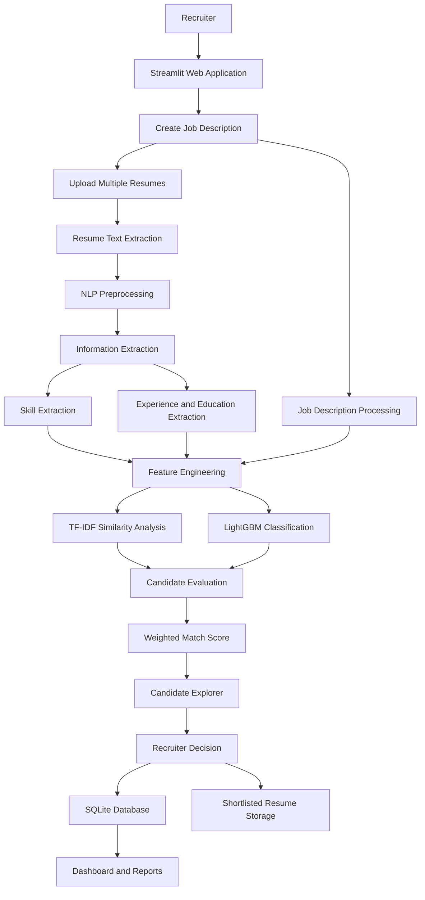

# HireNexa – AI-Powered Resume Screening and Recruitment Intelligence Platform

<p align="center">
  <strong>Transforming Resume Screening into Intelligent Recruitment Decisions</strong>
</p>

<p align="center">
  An AI-powered recruitment management platform that combines Machine Learning, Natural Language Processing, and automated resume analysis to help recruiters evaluate candidates efficiently.
</p>

<p align="center">
  
  
  
  
  
  
</p>

---

## 1. Project Overview

**HireNexa** is an AI-powered resume screening and recruitment management web application developed using Python, Machine Learning, Natural Language Processing (NLP), and Streamlit.

The platform helps recruiters analyze multiple resumes against a given job description, identify relevant skills, extract candidate experience, calculate job relevance scores, and organize candidates through a recruiter-controlled recruitment pipeline.

Traditional recruitment processes involve manually reviewing large numbers of resumes. This process can be time-consuming, repetitive, and difficult to manage when multiple job openings and candidates are involved.

HireNexa addresses these challenges by combining automated resume analysis with a centralized recruitment dashboard.

The application does not replace recruiters. Instead, it provides structured information and AI-assisted indicators that support human decision-making.

## 2. Problem Statement

Recruiters frequently receive hundreds or thousands of resumes for a single job opening.

Manually reviewing every resume creates several challenges:

- Time-consuming resume screening.
- Difficulty identifying relevant technical skills.
- Inconsistent evaluation across candidates.
- Difficulty comparing candidate profiles.
- Challenges identifying relevant work experience.
- Lack of centralized candidate information.
- Difficulty tracking shortlisted, rejected, and pending candidates.
- Manual preparation of recruitment reports.

There is a need for an intelligent recruitment platform that automates resume analysis, organizes candidate information, and provides recruiters with a centralized environment for managing the screening process.

**Proposed Solution:**

HireNexa provides an integrated recruitment platform that uses Machine Learning and NLP techniques to analyze resumes, compare them against job descriptions, generate candidate evaluation indicators, and maintain recruiter-controlled candidate records.

## 3. Project Objectives

The primary objectives of HireNexa are:

1. Automate the extraction of information from PDF and DOCX resumes.
2. Extract technical skills and educational qualifications.
3. Identify candidate experience from resume content.
4. Extract minimum and maximum experience requirements from job descriptions.
5. Compare resume content with job descriptions using TF-IDF similarity.
6. Generate predictions using a trained Machine Learning model.
7. Calculate an interpretable candidate matching score.
8. Provide a centralized recruiter dashboard.
9. Maintain separate storage for original and shortlisted resumes.
10. Store candidate records and recruiter decisions using SQLite.
11. Generate downloadable recruitment reports.
12. Deploy the application as an accessible web application.

## 4. Key Features

### 4.1 Recruitment Dashboard

Provides an overview of recruitment activities.

Features:
- Total job openings.
- Total screened candidates.
- Total shortlisted candidates.
- Average candidate matching score.
- Candidate decision distribution.
- Top candidate score visualization.
- Recent screening activity.

### 4.2 Job Description Management

Recruiters can create screening sessions by entering:

- Job title.
- Department or domain.
- Job description.
- Minimum experience.
- Maximum experience.

The application can automatically identify experience requirements from the job description.

### 4.3 Multiple Resume Upload

Recruiters can upload multiple candidate resumes in one screening session.

Supported formats:
- PDF
- DOCX

The application extracts readable text from the uploaded documents and processes each candidate separately.

### 4.4 Resume Information Extraction

The application extracts relevant information, including:

- Technical skills.
- Educational qualifications.
- Candidate experience.
- Certifications.
- Resume text.

### 4.5 Experience Range Extraction

One of the important features of HireNexa is its experience requirement extraction mechanism.

The application supports experience expressions such as:

| Job description expression | Extracted minimum | Extracted maximum |
|---|---:|---:|
| 0–4 years | 0 | 4 |
| 2 to 5 years | 2 | 5 |
| 3+ years | 3 | Open-ended |
| At least 2 years | 2 | Open-ended |
| Minimum 5 years | 5 | Open-ended |
| 4 years of experience | 4 | Open-ended |

Recruiters can also manually define the minimum and maximum experience requirements.

The manually specified experience range overrides the automatically extracted requirement.

**Note:** Candidate experience extraction depends on explicit experience statements in the resume. It is an estimate, not a complete employment-history verification system.

### 4.6 Skill Matching

HireNexa identifies skills from both the resume and the job description.

It categorizes the identified skills into:

- Matched skills.
- Missing skills.

Skill matching helps recruiters understand how closely a candidate's identified skills correspond to the job requirements.

### 4.7 TF-IDF Similarity Analysis

The application uses Term Frequency–Inverse Document Frequency (TF-IDF) to represent resume and job description text numerically.

Cosine similarity is then used to calculate textual similarity between the two documents.

The resulting similarity score indicates how closely the resume content matches the job description in the vectorized text representation.

### 4.8 Machine Learning Classification

HireNexa integrates a previously trained LightGBM model to generate candidate classifications.

The application loads three trained artifacts:

- `best_resume_screening_model.joblib`
- `label_encoder.joblib`
- `tfidf_vectorizer.joblib`

The trained model uses structured features extracted from resume and job description data.

The model produces a classification prediction and, when supported, class probabilities.

The application preserves the trained model's expected feature order when constructing the prediction input.

### 4.9 Candidate Matching Score

HireNexa calculates a weighted matching indicator using four evaluation components.

| Evaluation component | Weight |
|---|---:|
| Skill Matching | 50% |
| TF-IDF Similarity | 30% |
| Experience Matching | 15% |
| Education Matching | 5% |
| **Total** | **100%** |

Formula:

`Final Match Score = (Skill Score × 0.50) + (Similarity Score × 0.30) + (Experience Score × 0.15) + (Education Score × 0.05)`

This weighted score is a separate evaluation indicator from the LightGBM classification prediction.

It should not be interpreted as a probability of hiring success.

### 4.10 Candidate Explorer

Recruiters can explore screened candidate profiles.

Features:
- Search candidates.
- Filter by matching score.
- Filter by recruiter decision.
- View extracted skills.
- View missing skills.
- View experience and education.
- Review candidate evaluation scores.
- Download original resumes.

### 4.11 Recruiter-Controlled Shortlisting

Recruiters have complete control over candidate decisions.

Available decisions:

- Not Reviewed
- Shortlisted
- On Hold
- Rejected

Recruiters can also add notes to candidate profiles.

When a candidate is shortlisted, the original resume is copied into a separate shortlisted-candidates directory.

### 4.12 Candidate Comparison

Recruiters can compare multiple candidates based on:

- Overall matching score.
- Skill score.
- Text similarity.
- Experience score.
- Education score.
- AI classification.
- Recruiter decision.

Visual comparisons help recruiters evaluate candidates side by side.

### 4.13 Recruitment Pipeline

The recruitment pipeline organizes candidates according to their recruiter-assigned status.

It provides a centralized view of candidates in each stage.

### 4.14 Reports and History

HireNexa maintains screening history and provides downloadable recruitment reports.

Report information includes:

- Candidate name.
- Job title.
- AI classification.
- Matching score.
- Skill score.
- Similarity score.
- Experience.
- Education.
- Matched skills.
- Missing skills.
- Recruiter decision.
- Recruiter notes.
- Screening timestamp.

Reports can be downloaded in CSV format and saved in the reports directory.

### 4.15 Persistent Data Storage

The application uses SQLite for persistent storage.

It stores:

- Job information.
- Candidate information.
- Screening scores.
- AI classification.
- Recruiter decisions.
- Recruiter notes.
- Resume file locations.
- Shortlisted resume locations.

This allows records to remain available across application restarts when the underlying storage is persistent.

---

## 5. System Architecture

HireNexa follows a modular processing workflow.



## 6. Complete Application Workflow

The following describes how HireNexa processes a recruitment screening session.

### Step 1: Recruiter Access

The recruiter opens the deployed HireNexa application.

The recruiter accesses the dashboard and selects the New Screening section.

### Step 2: Job Creation

The recruiter enters:

- Job title.
- Department.
- Job description.
- Experience requirements.

The experience requirements can be extracted automatically or specified manually.

### Step 3: Resume Upload

The recruiter uploads multiple resumes in PDF or DOCX format.

Each uploaded resume is processed individually.

### Step 4: Resume Text Extraction

The application uses:

- PyMuPDF for PDF extraction.
- python-docx for DOCX extraction.

The extracted text is passed to the preprocessing stage.

### Step 5: NLP Preprocessing

The application performs text cleaning and normalization.

Operations include:

- Lowercasing.
- Removing HTML tags.
- Removing URLs.
- Removing email addresses.
- Removing phone-number patterns.
- Tokenization.
- Stopword removal.
- Lemmatization.

### Step 6: Information Extraction

The application identifies:

- Candidate skills.
- Education level.
- Experience information.
- Certifications.
- Resume domain.

### Step 7: Feature Engineering

The application generates structured features for model prediction.

The feature set includes:

- Resume skill count.
- Job description skill count.
- Education score.
- Experience years.
- Certification count.
- Resume word count.
- Job description word count.
- Matched skill count.
- Skill matching percentage.
- Skill Jaccard similarity.
- TF-IDF similarity.
- Education level.
- Resume domain.
- Job description domain.

### Step 8: TF-IDF Similarity

The resume and job description are transformed into TF-IDF vectors.

Cosine similarity calculates the similarity between the two vectors.

### Step 9: LightGBM Prediction

The structured features are passed to the trained LightGBM model.

The model generates a classification prediction.

The label encoder is used to decode encoded class predictions when applicable.

### Step 10: Weighted Candidate Evaluation

The application calculates the weighted matching score using:

- Skill matching.
- Text similarity.
- Experience matching.
- Education matching.

### Step 11: Candidate Storage

The original resume is stored in a job-specific directory.

Candidate screening information is saved in the SQLite database.

### Step 12: Recruiter Evaluation

The recruiter reviews each candidate and assigns a decision.

The recruiter can add comments and notes.

### Step 13: Shortlisting

If the recruiter selects Shortlisted, the resume is copied to the separate shortlisted-candidates directory.

### Step 14: Reports and Analytics

The recruiter can access:

- Recruitment dashboard.
- Candidate comparison.
- Recruitment pipeline.
- Screening history.
- CSV reports.

---

## 7. Technology Stack

| Technology | Purpose |
|---|---|
| Python | Core programming language |
| Streamlit | Web application development |
| Pandas | Data manipulation |
| NumPy | Numerical operations |
| Scikit-learn | TF-IDF and cosine similarity |
| LightGBM | Machine Learning classification |
| NLTK | NLP preprocessing |
| PyMuPDF | PDF text extraction |
| python-docx | DOCX text extraction |
| Joblib | Loading trained model artifacts |
| SQLite | Persistent application database |
| Plotly | Interactive visualizations |

## 8. Project Folder Structure

```text
HireNexa-AI-Resume-Screening/
│
├── app.py
│
├── requirements.txt
│
├── README.md
│
├── .gitignore
│
├── models/
│   ├── best_resume_screening_model.joblib
│   ├── label_encoder.joblib
│   └── tfidf_vectorizer.joblib
│
├── screenshots/
│   ├── dashboard.png
│   ├── new_screening.png
│   ├── candidate_explorer.png
│   ├── shortlisted_candidates.png
│   ├── compare_candidates.png
│   ├── recruitment_pipeline.png
│   └── reports.png
│
└── HireNexa_Storage/
    ├── hirenexa.db
    ├── resumes/
    ├── selected_candidates/
    ├── reports/
    └── job_descriptions/
```

**Note:** `HireNexa_Storage/` is generated automatically when the application runs. It should not be committed to a public repository because it contains candidate information and application records.

## 9. Installation and Local Setup

### Prerequisites

- Python 3.10 or compatible environment.
- Git.
- Visual Studio Code.
- Required trained model files.

### Step 1: Clone the Repository

```bash
git clone https://github.com/Naidu-DS-2026/HireNexa-AI-Resume-Screening.git
```

### Step 2: Navigate to the Project

```bash
cd HireNexa-AI-Resume-Screening
```

### Step 3: Create a Virtual Environment

```bash
python -m venv venv
```

Activate it on Windows:

```bash
venv\Scripts\activate
```

### Step 4: Install Dependencies

```bash
pip install -r requirements.txt
```

### Step 5: Verify Model Files

Make sure the following files are available:

```text
models/
    best_resume_screening_model.joblib
    label_encoder.joblib
    tfidf_vectorizer.joblib
```

### Step 6: Run the Application

```bash
streamlit run app.py
```

The application will open in your default browser.

## 10. Requirements

The project dependencies are listed in `requirements.txt`.

```text
streamlit
pandas
numpy
joblib
pymupdf
python-docx
nltk
plotly
scikit-learn
lightgbm
```

## 11. Database Design

HireNexa uses SQLite for persistent application data.

### Jobs Table

Stores information about each recruitment screening session.

| Column | Description |
|---|---|
| job_id | Unique job identifier |
| title | Job title |
| domain | Job domain |
| description | Job description |
| min_experience | Minimum experience |
| max_experience | Maximum experience |
| created_at | Job creation timestamp |
| candidate_count | Number of processed candidates |

### Candidates Table

Stores candidate screening and recruiter information.

| Column | Description |
|---|---|
| candidate_id | Unique candidate identifier |
| job_id | Associated job identifier |
| candidate_name | Candidate resume filename |
| resume_filename | Original resume filename |
| resume_path | Original resume location |
| selected_resume_path | Shortlisted resume location |
| prediction | ML classification |
| final_score | Weighted matching score |
| skill_score | Skill matching score |
| similarity_score | TF-IDF similarity score |
| experience_score | Experience score |
| education_score | Education score |
| experience | Extracted experience |
| education | Extracted education |
| recruiter_decision | Recruiter decision |
| recruiter_notes | Recruiter comments |
| result_json | Additional structured screening results |
| created_at | Screening timestamp |

## 12. Data Storage Structure

The application automatically creates the following storage directories:

```text
HireNexa_Storage/
│
├── hirenexa.db
│
├── resumes/
│   ├── job_id_1/
│   │   ├── resume_1.pdf
│   │   └── resume_2.docx
│   │
│   └── job_id_2/
│       └── resume_3.pdf
│
├── selected_candidates/
│   ├── job_id_1/
│   │   └── shortlisted_resume.pdf
│   │
│   └── job_id_2/
│
├── job_descriptions/
│   └── job_description.txt
│
└── reports/
    └── recruitment_report.csv
```

The actual directory names are job IDs generated by the application.

## 13. Deployment

HireNexa is deployed using **Streamlit Community Cloud**.

General deployment process:

1. Upload the project source code to GitHub.
2. Include the required model artifacts.
3. Add `requirements.txt`.
4. Create a Streamlit Community Cloud application.
5. Connect the GitHub repository.
6. Select `app.py` as the application entry point.
7. Deploy the application.
8. Verify the model loading and application functionality.

**Live Application:** [Add your deployed HireNexa URL here]

**GitHub Repository:** [HireNexa-AI-Resume-Screening](https://github.com/Naidu-DS-2026/HireNexa-AI-Resume-Screening)

**Deployment consideration:** Streamlit Cloud's local filesystem should not be treated as permanent storage across all restarts or redeployments. For production use, configure persistent external storage for resumes, database records, and reports.

## 14. Security and Privacy Considerations

Candidate resumes contain personal information. The application should be used responsibly.

Important considerations:

- Do not upload real candidate resumes to a public GitHub repository.
- Do not publish candidate personal information.
- Keep application databases outside version control.
- Do not expose private credentials.
- Restrict access to candidate records.
- Obtain appropriate authorization before processing candidate information.
- Configure persistent and secure storage for production deployment.
- Define retention and deletion policies for candidate records.

## 15. Limitations

Current application limitations include:

1. Experience extraction depends on explicit wording in the resume.
2. Scanned PDFs may require OCR before text can be extracted.
3. Skill extraction relies on the configured skill dictionary.
4. Education extraction uses keyword and pattern matching.
5. TF-IDF measures textual similarity, not complete semantic understanding.
6. Candidate matching scores are indicators and should not be treated as hiring probabilities.
7. The trained model's performance depends on its training data and evaluation.
8. SQLite and local file storage require additional infrastructure for a multi-user production deployment.
9. Candidate experience and qualifications should be verified by recruiters.

## 16. Future Enhancements

Potential future improvements include:

- Semantic resume matching using Sentence Transformers.
- Large Language Model-based resume summarization.
- Retrieval-Augmented Generation (RAG) for candidate profile queries.
- OCR support for scanned resumes.
- More advanced employment-history extraction.
- Skills taxonomy and synonym recognition.
- Role-specific candidate ranking.
- Recruiter authentication and role-based access control.
- Cloud database integration.
- Cloud object storage for resume files.
- Automated email communication.
- Interview scheduling integration.
- Advanced analytics and recruitment KPIs.
- Audit logs and candidate data retention management.

## 17. Project Outcomes

HireNexa brings multiple recruitment activities into one web application.

The project demonstrates practical implementation of:

- End-to-end Machine Learning integration.
- NLP-based document processing.
- Resume and job description analysis.
- Feature engineering.
- Text vectorization and similarity analysis.
- ML model inference.
- Database integration.
- File management.
- Interactive dashboards.
- Recruiter workflow management.
- Web application deployment.

It provides a practical example of applying Data Science and Machine Learning concepts to a real-world recruitment workflow.

## 18. Author

**Thirumala Naidu**

B.Tech – Computer Science and Engineering (Artificial Intelligence and Machine Learning)

**Technical Interests:**
- Data Science
- Machine Learning
- Natural Language Processing
- Generative AI
- Python
- Data Analytics

**GitHub:** https://github.com/Naidu-DS-2026

**LinkedIn:** https://www.linkedin.com/in/thirumala-naidu-b7a908289

---

## 19. Acknowledgement

This project was developed as a practical implementation of Machine Learning, Natural Language Processing, Python programming, and web application development.

The objective is to demonstrate how intelligent document processing and data-driven evaluation can support recruitment operations while keeping final hiring decisions under human control.

---

<p align="center">
  <strong>HireNexa – Smarter Screening. Structured Recruitment. Better Decisions.</strong>
</p>
